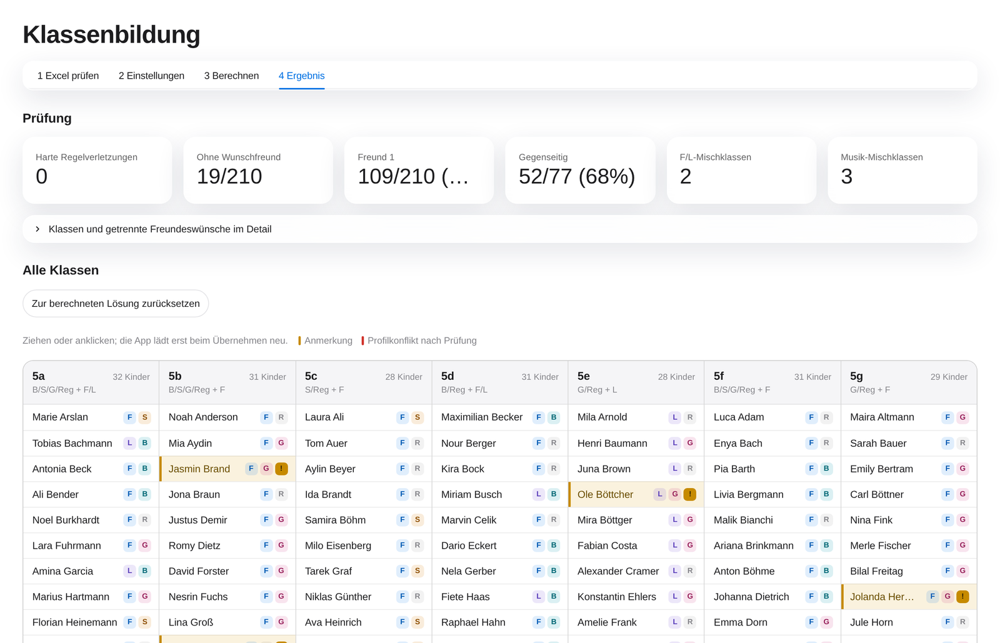
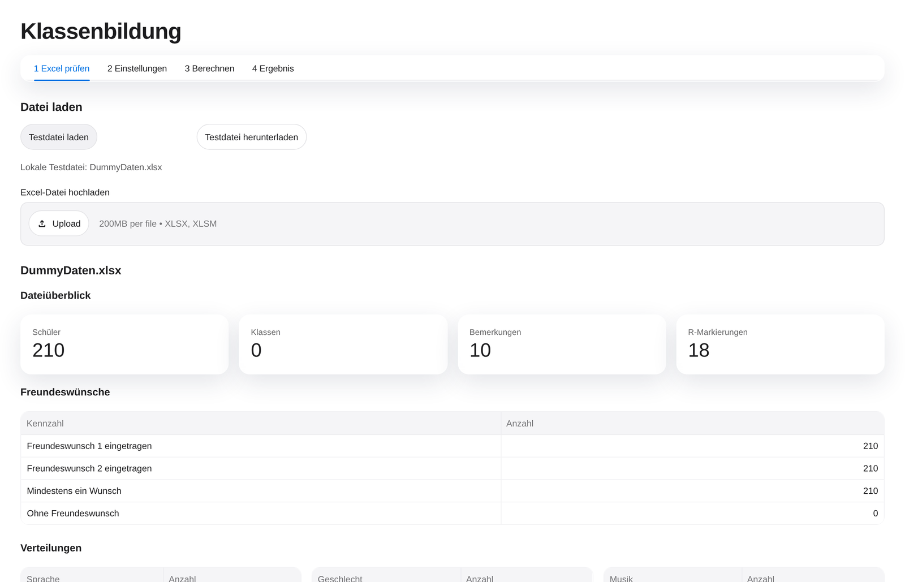
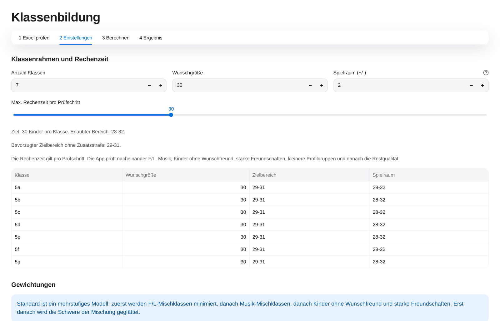

<div align="center">


# Klassenbildung

**Faire Klassen aus einer Excel-Liste – automatisch berechnet, lokal auf dem eigenen Rechner.**

Freundeswünsche, Sprachen, Musikprofile und Klassengrößen werden gemeinsam abgewogen.
Das Ergebnis lässt sich per Drag-and-drop nachbearbeiten und als Excel exportieren.

[](https://github.com/jonassneu/klassenbildung-go-local/releases/latest)


[**Herunterladen**](#installation) · [**So funktioniert's**](#so-funktionierts) · [**Selbst bauen**](#entwickler)

<br>

<picture>
  <source media="(prefers-color-scheme: dark)" srcset="docs/images/ergebnis-dark.png">
  
</picture>

</div>

---

## ✨ Funktionen

<table>
<tr>
<td width="50%" valign="top">

**🧮 Optimierung statt Bauchgefühl**<br>
Ein mehrstufiges Modell mit Google OR-Tools (CP-SAT) erfüllt Freundeswünsche, hält
gegenseitige Freundschaften zusammen und verteilt Sprachen und Musikprofile möglichst
ohne Mischklassen.

</td>
<td width="50%" valign="top">

**🔒 Komplett lokal**<br>
Schülerdaten verlassen nie den Rechner. Die App läuft im Browser unter
`localhost`, braucht nach der Installation kein Internet und speichert nichts in der Cloud.

</td>
</tr>
<tr>
<td valign="top">

**✅ Harte Regeln, klar geprüft**<br>
Klassengröße, höchstens 10 Kinder aus derselben Grundschule, höchstens 4
Unterstützungsmarkierungen je Klasse – Verstöße werden rot markiert und im Export vermerkt.

</td>
<td valign="top">

**🖱️ Nachbearbeiten per Drag-and-drop**<br>
Kinder lassen sich zwischen Klassen verschieben. Notizen, Profilkonflikte und manuelle
Regeln bleiben sichtbar; nach dem Übernehmen werden die Kennzahlen neu geprüft.

</td>
</tr>
<tr>
<td valign="top">

**📊 Excel rein, Excel raus**<br>
Die Schülerliste wird aus dem Blatt `Basis` gelesen und vor der Berechnung auf Fehler
geprüft. Das Ergebnis wird wieder als Excel-Datei exportiert.

</td>
<td valign="top">

**📦 Ein Klick zur Installation**<br>
Fertige Pakete für Linux (`.rpm`/`.deb`) und macOS (`.app`) mit eingebautem Python –
nichts muss vorher installiert werden.

</td>
</tr>
</table>

<a id="so-funktionierts"></a>

## 🧭 So funktioniert's

Die App führt in vier Schritten durch die Klassenbildung. Eine Testdatei mit 210
Beispielkindern ([`DummyDaten.xlsx`](DummyDaten.xlsx)) ist eingebaut und lässt sich mit
einem Klick laden.

### 1 · Excel prüfen

Schülerliste hochladen. Die App zeigt einen Dateiüberblick, die Freundeswünsche und die
Verteilung nach Sprache, Geschlecht und Musikprofil. Blockierende Fehler wie fehlende
Schülernummern oder mehrdeutige Freundeseinträge werden sofort angezeigt.

<picture>
  <source media="(prefers-color-scheme: dark)" srcset="docs/images/excel-pruefen-dark.png">
  
</picture>

### 2 · Einstellungen

Anzahl Klassen, Wunschgröße und Spielraum festlegen. Über die Gewichtungen wird gesteuert,
wie stark die einzelnen Ziele gegeneinander abgewogen werden. Die empfohlenen Werte sind
mit einem Klick wiederhergestellt.

<picture>
  <source media="(prefers-color-scheme: dark)" srcset="docs/images/einstellungen-dark.png">
  
</picture>

### 3 · Berechnen

`Klassen vorschlagen` startet die Optimierung. Ein Fortschrittsbalken zeigt den aktuellen
Prüfschritt. Für rund 210 Kinder dauert ein Lauf etwa zwei Minuten.

### 4 · Ergebnis

Kennzahlen auf einen Blick, alle Klassen als Spalten (siehe Bild ganz oben). Ein Klick auf
ein Kind öffnet eine Detailkarte; per Drag-and-drop wird es in eine andere Klasse
verschoben. Zum Schluss das Ergebnis als Excel exportieren.

Die ausführliche Anleitung für Schulen steht in
[`docs/school_user_workflow.md`](docs/school_user_workflow.md).

<a id="installation"></a>

## 📥 Installation

| System | Download | Hinweis |
| --- | --- | --- |
| 🐧 **Fedora, Nobara, openSUSE** | [`Klassenbildung-1.0.0-1.x86_64.rpm`](https://github.com/jonassneu/klassenbildung-go-local/releases/latest) | Doppelklicken → **Installieren** |
| 🐧 **Ubuntu, Debian, Linux Mint** | [`Klassenbildung_1.0.0-1_amd64.deb`](https://github.com/jonassneu/klassenbildung-go-local/releases/latest) | Doppelklicken → **Installieren** |
| 🍎 **macOS** | [`Klassenbildung-macOS.zip`](https://github.com/jonassneu/klassenbildung-go-local/releases/latest) | Entpacken, nach `/Programme` ziehen |
| 🪟 **Windows** | Quellcode | `start_klassenbildung.bat` doppelklicken |

### 🐧 Linux

Beide Pakete enthalten Python 3.12, Streamlit, OR-Tools und alle weiteren Module. Nach der
Installation steht **Klassenbildung** im App-Menü. Beim ersten Start wird keine
Internetverbindung gebraucht. Einstellungen und Klassenprofile bleiben im Benutzerkonto.

Die Pakete sind für 64-Bit-x86-Linux mit glibc 2.28 oder neuer gebaut; die RPM-Datei wird
auf Nobara getestet.

<details>
<summary>Andere Architekturen: Quellpaket <code>Klassenbildung-Linux-Installer.tar.gz</code></summary>

<br>

Für andere Architekturen bleibt das Quellpaket `Klassenbildung-Linux-Installer.tar.gz` als
technischer Ausweichweg. Dieses Archiv muss vor dem Start vollständig entpackt werden; ein
Archivmanager kann daraus keine Programme ausführen. Dieser Weg installiert beim ersten
Durchlauf eine eigene Python-Laufzeit und benötigt Internet.

</details>

### 🍎 macOS

`Klassenbildung-macOS.zip` aus den [Releases](https://github.com/jonassneu/klassenbildung-go-local/releases/latest)
entpacken und `Klassenbildung.app` nach `/Programme` ziehen – Python muss dafür **nicht**
installiert sein.

> [!WARNING]
> Die App ist **nicht signiert und nicht notarisiert**. macOS zeigt deshalb beim ersten Start:
>
> *„Klassenbildung“ konnte nicht geöffnet werden. Apple kann nicht überprüfen, ob
> „Klassenbildung“ frei von Malware ist …*
>
> Das ist erwartet und kein Fehler der App.

**Lösung per Terminal (zuverlässig, empfohlen):**

```bash
xattr -dr com.apple.quarantine /Applications/Klassenbildung.app
```

Danach startet die App normal per Doppelklick.

<details>
<summary>Alternative über die Systemeinstellungen (ab macOS 13)</summary>

<br>

App doppelklicken, Meldung mit *Fertig* schließen, dann *Systemeinstellungen* →
*Datenschutz & Sicherheit* → nach unten scrollen → bei „Klassenbildung wurde blockiert…“ auf
*Dennoch öffnen* klicken.

> [!NOTE]
> Der frühere Weg „Rechtsklick → Öffnen“ funktioniert ab macOS 15 (Sequoia) nicht mehr.

</details>

Einstellungen und Klassenprofile werden unter
`~/Library/Application Support/Klassenbildung/` gespeichert.

### 🪟 Windows & manueller Start

Unter Windows `start_klassenbildung.bat` doppelklicken. Unter macOS und Linux funktioniert
derselbe Weg mit:

```bash
./start_klassenbildung.sh          # macOS: alternativ start_klassenbildung.command im Finder
```

Das Skript legt beim ersten Start eine virtuelle Umgebung (`.venv`) an, installiert die
Abhängigkeiten und öffnet <http://localhost:6767> im Browser.

> [!IMPORTANT]
> Für den manuellen Start wird **Python 3.11 oder neuer** benötigt. Das mit macOS
> ausgelieferte Python 3.9 reicht nicht aus – z. B. per Homebrew installieren:
> `brew install python@3.13`

<a id="entwickler"></a>

## 🛠️ Für Entwickler

```text
klassenbildung/
├── excel_io/        Excel-Import und -Export
├── validation/      Prüfung der Eingabedaten und harten Regeln
├── optimization/    CP-SAT-Modell und Bewertung
├── services/        manuelle Regeln, Notizen, Kandidatenauswahl
├── presentation/    Kennzahlen und Texte für die Oberfläche
├── components/      Drag-and-drop-Klassenboard
└── ui/              Theme und Tabellen
app.py               Streamlit-Einstieg
```

**Tests ausführen:**

```bash
.venv/bin/python -m pytest
```

<details>
<summary><b>🐧 Native Linux-Pakete bauen</b></summary>

<br>

```bash
./build_linux/build_native_packages.sh
```

Der Standard-Build nutzt einen `manylinux_2_28`-Container und erzeugt RPM, DEB und
`SHA256SUMS` unter `build_linux/packages/`. Mit `KB_NATIVE_LOCAL=1` kann lokal gebaut werden,
das Ergebnis benötigt dann unter Umständen eine neuere glibc-Version.

**Benutzerkonto-Installationspaket (technischer Ausweichweg):**

```bash
./build_linux/build_installer.sh
```

Ergebnis: `build_linux/dist/Klassenbildung-Linux-Installer.tar.gz` plus SHA-256-Datei.

</details>

<details>
<summary><b>🍎 macOS-App bauen</b></summary>

<br>

```bash
./build_macos/build.sh
```

Ergebnis: `build_macos/dist/Klassenbildung.app` und `build_macos/dist/Klassenbildung-macOS.zip`.

</details>

<details>
<summary><b>🔏 macOS-App signieren und notarisieren (optional)</b></summary>

<br>

Damit die Gatekeeper-Meldung dauerhaft verschwindet, muss die App mit einer Apple-Developer-ID
signiert und von Apple notarisiert werden. Voraussetzung ist das
[Apple Developer Program](https://developer.apple.com/programs/) (99 USD/Jahr).

**Einmalig einrichten:**

1. Zertifikat vom Typ **„Developer ID Application“** erstellen und in den Schlüsselbund laden.
   Nur dieser Typ funktioniert außerhalb des App Store – „Apple Development“ oder
   „Apple Distribution“ werden von Gatekeeper abgelehnt. Vorhandene Identitäten anzeigen:

   ```bash
   security find-identity -v -p codesigning
   ```

2. App-spezifisches Passwort auf https://account.apple.com erzeugen und den Notar-Zugang
   im Schlüsselbund hinterlegen:

   ```bash
   xcrun notarytool store-credentials "klassenbildung" \
       --apple-id "DEINE@APPLE.ID" --team-id "DEINETEAMID" \
       --password "app-spezifisches-passwort"
   ```

**Bauen, signieren, notarisieren:**

```bash
KB_CODESIGN_IDENTITY="Developer ID Application: Dein Name (TEAMID)" \
KB_NOTARY_PROFILE="klassenbildung" \
./build_macos/build.sh
```

Das Skript signiert alle eingebetteten Bibliotheken einzeln, aktiviert die Hardened Runtime,
lädt die App bei Apple hoch, wartet auf das Ergebnis, heftet das Ticket an die App
(`stapler`) und packt sie neu. Die Notarisierung dauert meist wenige Minuten.

Die nötigen Ausnahmen für CPython (`allow-unsigned-executable-memory`, `allow-jit`,
`disable-library-validation`) stehen in `build_macos/entitlements.plist` – ohne sie startet
die App unter Hardened Runtime nicht.

</details>

---

<div align="center">
<sub>Alle Namen in den Screenshots stammen aus der fiktiven Testdatei <code>DummyDaten.xlsx</code>.</sub>
</div>
