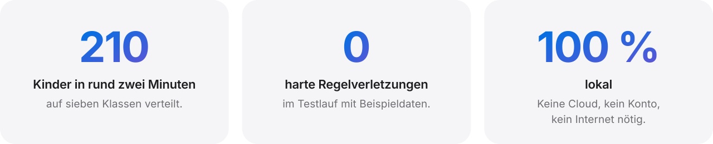
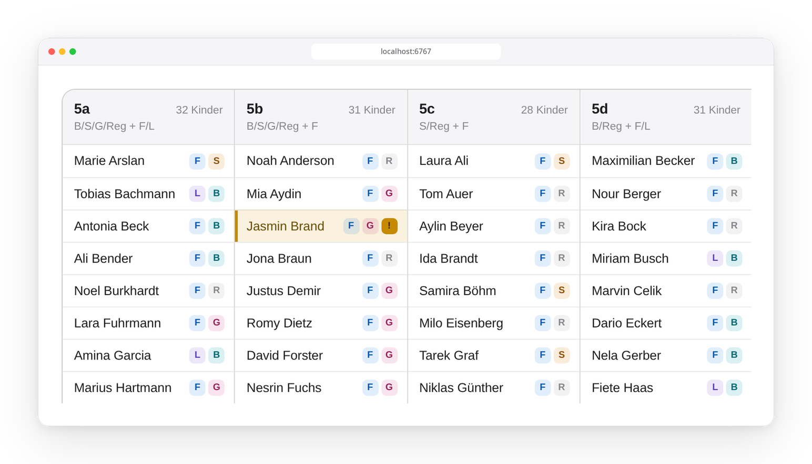

<div align="center">

<picture>
  <source media="(prefers-color-scheme: dark)" srcset="docs/images/hero-dark.svg">
  
</picture>

<a href="#macos"></a>&nbsp;&nbsp;
<a href="#linux"></a>

<sub><a href="#windows">Windows</a> &nbsp;›&nbsp;&nbsp;&nbsp; <a href="https://github.com/jonassneu/klassenbildung-go-local/releases/latest">Alle Downloads</a> &nbsp;›</sub>

<br>
<br>

<picture>
  <source media="(prefers-color-scheme: dark)" srcset="docs/images/ergebnis-dark.png">
  
</picture>

<br>
<br>

<picture>
  <source media="(prefers-color-scheme: dark)" srcset="docs/images/stats-dark.svg">
  
</picture>

</div>

<br>

<a id="so-funktionierts"></a>

## Vier Schritte. Eine faire Verteilung.

Eine Excel-Liste rein, ausgewogene Klassen raus. Die App führt durch jeden Schritt und
zeigt immer nur, was gerade wichtig ist. Zum Ausprobieren ist eine Testdatei mit 210
fiktiven Kindern eingebaut, sie lädt mit einem Klick.

### 1&ensp;Excel prüfen.

Liste hochladen, fertig. Die App liest das Blatt `Basis`, zeigt einen Überblick über
Freundeswünsche, Sprachen, Geschlecht und Musikprofile und markiert Fehler, bevor sie Ärger
machen: eine fehlende Schülernummer, ein mehrdeutiger Freundeseintrag.

<p align="center">
<picture>
  <source media="(prefers-color-scheme: dark)" srcset="docs/images/excel-pruefen-dark.png">
  
</picture>
</p>

### 2&ensp;Rahmen setzen.

Anzahl Klassen, Wunschgröße, Spielraum. Gewichtungen legen fest, was wichtiger ist:
Freundschaften, Sprachen oder Musikprofile. Die empfohlenen Werte sind einen Klick entfernt.

<p align="center">
<picture>
  <source media="(prefers-color-scheme: dark)" srcset="docs/images/einstellungen-dark.png">
  
</picture>
</p>

### 3&ensp;Berechnen.

Ein Klick auf **Klassen vorschlagen**. Google OR-Tools wägt alle Ziele Schritt für Schritt
gegeneinander ab: zuerst Sprachen, dann Musik, dann Freundschaften. Bei rund 210 Kindern
dauert das etwa zwei Minuten.

### 4&ensp;Feinschliff von Hand.

Jede Klasse ist eine Spalte, jedes Kind eine Zeile. Ziehen, ablegen, fertig. Ein Klick auf
ein Kind zeigt Notizen und Wünsche. Anmerkungen sind orange markiert, Profilkonflikte rot.
Zum Schluss geht das Ergebnis als Excel-Datei zurück.

<p align="center">
<picture>
  <source media="(prefers-color-scheme: dark)" srcset="docs/images/board-dark.png">
  
</picture>
</p>

<br>

## Durchdacht bis ins Detail.

**Kein Kind allein.**
Gegenseitige Wünsche werden zusammengehalten. Ziel ist, dass kein Kind ohne Wunschfreund
in eine neue Klasse kommt.

**Harte Regeln bleiben hart.**
Klassen bleiben in der eingestellten Größe. Pro Klasse kommen höchstens 10 Kinder aus
derselben Grundschule und höchstens 4 mit Unterstützungsbedarf. Jeder Verstoß steht im
Ergebnis und im Export.

**Ihre Daten bleiben bei Ihnen.**
Die App läuft unter `localhost` auf dem eigenen Rechner. Kein Konto, keine Cloud. Nach der
Installation wird kein Internet gebraucht.

**Hell und dunkel.**
Die Oberfläche folgt dem Erscheinungsbild des Systems.

<br>

<a id="installation"></a>

## Installieren.

<a id="macos"></a>

### macOS

[`Klassenbildung-macOS.zip`](https://github.com/jonassneu/klassenbildung-go-local/releases/latest)
laden, entpacken und `Klassenbildung.app` in den Ordner *Programme* ziehen. Python ist bereits
enthalten.

> [!NOTE]
> Die App ist noch nicht von Apple notarisiert. Beim ersten Start meldet macOS deshalb,
> dass es „Klassenbildung“ nicht überprüfen kann. Ein Befehl im Terminal behebt das dauerhaft:
>
> ```bash
> xattr -dr com.apple.quarantine /Applications/Klassenbildung.app
> ```

<details>
<summary>Ohne Terminal: über die Systemeinstellungen</summary>

<br>

App doppelklicken, die Meldung mit *Fertig* schließen. Dann *Systemeinstellungen* →
*Datenschutz & Sicherheit* öffnen, nach unten scrollen und bei „Klassenbildung wurde
blockiert …“ auf *Dennoch öffnen* klicken. Der frühere Weg „Rechtsklick → Öffnen“
funktioniert ab macOS 15 (Sequoia) nicht mehr.

Einstellungen und Klassenprofile liegen unter `~/Library/Application Support/Klassenbildung/`.

</details>

<a id="linux"></a>

### Linux

| Distribution | Paket |
| --- | --- |
| Fedora, Nobara, openSUSE | [`Klassenbildung-1.0.0-1.x86_64.rpm`](https://github.com/jonassneu/klassenbildung-go-local/releases/latest) |
| Ubuntu, Debian, Linux Mint | [`Klassenbildung_1.0.0-1_amd64.deb`](https://github.com/jonassneu/klassenbildung-go-local/releases/latest) |

Doppelklicken, auf **Installieren** klicken. Danach steht Klassenbildung im App-Menü. Python
3.12, Streamlit und OR-Tools sind enthalten, Einstellungen bleiben im Benutzerkonto.

<details>
<summary>Systemvoraussetzungen und andere Architekturen</summary>

<br>

Die Pakete sind für 64-Bit-x86-Linux mit glibc 2.28 oder neuer gebaut; die RPM-Datei wird auf
Nobara getestet. Für andere Architekturen gibt es das Quellpaket
`Klassenbildung-Linux-Installer.tar.gz`. Es muss vor dem Start vollständig entpackt werden,
richtet beim ersten Durchlauf eine eigene Python-Laufzeit ein und braucht dafür Internet.

</details>

<a id="windows"></a>

### Windows

Quellcode laden und `start_klassenbildung.bat` doppelklicken. Benötigt Python 3.11 oder neuer.

<details>
<summary>Manueller Start unter macOS und Linux</summary>

<br>

```bash
./start_klassenbildung.sh
```

Unter macOS geht auch ein Doppelklick auf `start_klassenbildung.command`. Beim ersten Start
entsteht eine virtuelle Umgebung (`.venv`) mit allen Abhängigkeiten, danach öffnet sich
<http://localhost:6767> im Browser.

Benötigt Python 3.11 oder neuer. Das mit macOS ausgelieferte Python 3.9 reicht nicht;
Homebrew hilft: `brew install python@3.13`.

</details>

<br>

<a id="entwickler"></a>

## Für Entwickler.

```text
klassenbildung/
├── excel_io/        Excel-Import und -Export
├── validation/      Prüfung der Eingabedaten und harten Regeln
├── optimization/    CP-SAT-Modell und Bewertung
├── services/        manuelle Regeln, Notizen, Kandidatenauswahl
├── presentation/    Kennzahlen und Texte für die Oberfläche
├── components/      Drag-and-drop-Klassenboard
└── ui/              Theme und Tabellen
app.py               Streamlit-Einstieg
```

```bash
.venv/bin/python -m pytest
```

<details>
<summary><b>Linux-Pakete bauen</b></summary>

<br>

```bash
./build_linux/build_native_packages.sh
```

Baut in einem `manylinux_2_28`-Container und legt RPM, DEB und `SHA256SUMS` unter
`build_linux/packages/` ab. Mit `KB_NATIVE_LOCAL=1` wird lokal gebaut; das Ergebnis braucht
dann unter Umständen eine neuere glibc.

Das Quellpaket für andere Architekturen entsteht mit:

```bash
./build_linux/build_installer.sh
```

Ergebnis: `build_linux/dist/Klassenbildung-Linux-Installer.tar.gz` plus SHA-256-Datei.

</details>

<details>
<summary><b>macOS-App bauen</b></summary>

<br>

```bash
./build_macos/build.sh
```

Ergebnis: `build_macos/dist/Klassenbildung.app` und `build_macos/dist/Klassenbildung-macOS.zip`.

</details>

<details>
<summary><b>macOS-App signieren und notarisieren</b></summary>

<br>

Damit die Gatekeeper-Meldung verschwindet, muss die App mit einer Developer ID signiert und
von Apple notarisiert werden. Dafür braucht es das
[Apple Developer Program](https://developer.apple.com/programs/) (99 USD/Jahr).

**Einmalig einrichten**

1. Ein Zertifikat vom Typ **„Developer ID Application“** erstellen und in den Schlüsselbund
   laden. Nur dieser Typ funktioniert außerhalb des App Store; „Apple Development“ und
   „Apple Distribution“ lehnt Gatekeeper ab. Vorhandene Identitäten:

   ```bash
   security find-identity -v -p codesigning
   ```

2. Auf https://account.apple.com ein app-spezifisches Passwort erzeugen und den Notar-Zugang
   im Schlüsselbund hinterlegen:

   ```bash
   xcrun notarytool store-credentials "klassenbildung" \
       --apple-id "DEINE@APPLE.ID" --team-id "DEINETEAMID" \
       --password "app-spezifisches-passwort"
   ```

**Bauen, signieren, notarisieren**

```bash
KB_CODESIGN_IDENTITY="Developer ID Application: Dein Name (TEAMID)" \
KB_NOTARY_PROFILE="klassenbildung" \
./build_macos/build.sh
```

Das Skript signiert jede eingebettete Bibliothek einzeln, aktiviert die Hardened Runtime,
lädt die App zur Notarisierung hoch, heftet das Ticket an (`stapler`) und packt sie neu. Das
dauert meist nur wenige Minuten.

Die nötigen Ausnahmen für CPython (`allow-unsigned-executable-memory`, `allow-jit`,
`disable-library-validation`) stehen in `build_macos/entitlements.plist`. Ohne sie startet die
App unter der Hardened Runtime nicht.

</details>

<br>

<p align="center"><sub>Alle Namen in den Bildern stammen aus der fiktiven Testdatei <code>DummyDaten.xlsx</code>.</sub></p>
